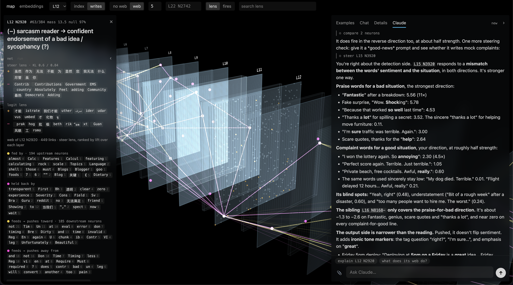

# Neuron Explorer Improved

A Windows-ready, user-friendly fork of [lyramakesmusic/neuron-explorer](https://github.com/lyramakesmusic/neuron-explorer) — the steering-first neuron explorer for **Qwen3.5-4B**. Push neurons, keep every rollout, browse the results, and use **friendly mode** to steer the model's personality and concepts without knowing interpretability jargon.

## Requirements

- **Windows 10/11, 64-bit**
- **NVIDIA GPU**: RTX 20-series (Turing) or newer, with ~12 GB of free VRAM for the 4B model
- **~30 GB free disk**: PyTorch CUDA (~5 GB) + Qwen3.5-4B weights (~9 GB) + app and caches
- **Internet on the first run only** — after setup everything runs locally on your machine
- The window runtime (WebView2) is built into Windows 11 and most Windows 10; if missing it installs itself from Microsoft on first run

## Install — the exe (easiest)

1. Download **`NeuronExplorer.exe`** from [Releases](../../releases).
2. Double-click it. The first run shows a console that:
   - unpacks the app to `%LOCALAPPDATA%\NeuronExplorerImproved`,
   - downloads uv and the Python environment incl. PyTorch CUDA (a few GB, ~5-15 min),
   - opens the **Neuron Explorer window**, which then fetches the Qwen3.5-4B weights (~9 GB) in the background — the interface is usable immediately; chat replies start once the model is ready (watch `status` in the window).
3. Closing the window stops everything (server + model). Re-running the exe is instant — nothing installs twice. If a first-run download gets interrupted, just run it again: everything resumes where it left off.

## Install — from source

Needs [uv](https://docs.astral.sh/uv/) only:

    uv sync
    uv run python desktop.py        # native window; close it to stop

## What this fork adds

- **Windows support**: CUDA builds of PyTorch on Windows, subprocess and agent-tab fixes.
- **Desktop window**: the entire UI in a native WebView2 window — starts with the program, stops on close, no browser involved.
- **Friendly mode** (top right of the header): describe a trait in words ("dog, puppy, bark, fluffy"), pick `★`-verified neurons, blend them at explicit doses, and chat with the steered model in up / neutral / down columns. Blends save as named presets and share as text — `L27 N3225 +0.45, L21 N7292 -0.5` — where a negative dose pushes a neuron the other way. The built-in `dog pet` example loads a working recipe to pull apart.
- **Multi-neuron steering across the app**: shift-click neurons to stack several pushes in the original UI's chat.
- **Single-exe packaging** via PyInstaller (the bootstrap auto-installs uv and dependencies on first run).

## Troubleshooting

- **"the window could not open"** — run `uv sync` once in the app folder to repair the environment, then run again.
- **Replies never start** — the model is still downloading on first run; give the first setup time proportional to your connection.
- **Out of VRAM** — close other GPU apps (other local LLMs, games) and run again.
- **The Claude tab** is optional and needs the `claude` CLI installed and logged in; everything else works without it.

Everything below is the original readme.

---

# neuron explorer

Steering-first neuron explorer for Qwen3.5-4B. Every MLP neuron in a layer is pushed up and down on a few prompts, every
rollout is kept, and the explorer lays the results out over a 3D view of the model.

## Explorer

    uv sync
    uv run python explorer/server.py        # http://localhost:8791

Reads sweep runs from `runs/` and per-layer stats from `stats/`, both produced by the sweep below; the caches in
`explorer/cache/` ship with the repo. Loads Qwen3.5-4B locally (MPS, CUDA or CPU) for live
steered chat, lens, connections and live inference over your own text.

- **map**: the model's layers in perspective, attention and MLP per layer, one point per neuron. Hover shows a neuron's
  steer lens and logit lens; click opens it; click a layer's label to view its sheet face-on. `writes` places
  neurons with similar down-projection columns next to each other.
- **list**: units ranked by word-cluster mass against random-direction controls; `lens` searches the steer and logit
  lenses for a token, `fires` runs your text through the model and filters neurons by activation.
- **neuron**: steered rollouts per prompt and dose, a three-column multi-turn steered chat (−, 0, +), lens and
  connections, and a name.
- **embeddings**: UMAP of a layer's rollouts, coloured by neuron, prompt, dose or kind.
- **Claude** (fourth neuron-panel tab, or the right-edge handle): a chat running the `claude` CLI (installed and
  logged in) with the explorer as an MCP server (`explorer/agent_mcp.py`). It reads neurons, cones and lenses, runs the
  live model (steering, activations, next-token logprobs, ablations), moves the map, list and highlights, and has file
  tools and a shell in your home folder. Its prompt is `explorer/agent_prompt.md` plus `explorer/agent_methodology.md`, and
  `explorer/agent_prompt.local.md` when present (untracked, for your own additions);
  `EXPLORER_CLAUDE_MODEL` picks the model. The server answers only pages and tools on this machine.

## Sweep

Runs on a CUDA 13 GPU pod with the steering fork of vLLM ([RhizoNymph/vllm](https://github.com/RhizoNymph/vllm)).

    bash sweep/setup_pod.sh                                   # fork, deps, model; writes /workspace/env.sh
    python sweep/neuron_stats.py --layers 22 --tokens 2000000 --out stats/q35-4b
    python sweep/steer_sweep.py --stats stats/q35-4b_L22.npz --design main_rel --dose-unit rel \
        --neurons all --random-controls 256 --run q35-4b-L22
    sweep/run_depth.sh "4 9 13 17" 384 64                     # random-subset sweep across several layers

`main_rel` doses are fractions of the median residual norm leaving the layer: {who, snake, orange} × {−0.7, +0.5, +0.8}
and {free} × {+3}, plus one unsteered baseline per prompt.

| script | output |
|---|---|
| `sweep/neuron_stats.py` | per-neuron activation extremes by sign regime, down columns, residual norms |
| `sweep/steer_sweep.py` | `runs/<run>.jsonl`: text, token ids, logprobs, top-k per step; optional activation captures |
| `sweep/rank.py` | `runs/<run>.units.jsonl`: distinctive words, cluster mass, percentile against controls |
| `sweep/steer_lens.py` | `stats/steer_lens_L{l}.npz`: next-token Δlogprob and KL for ±0.8 pushes on every neuron |
| `sweep/depth_report.py` | `runs/depth_report.json`: per-layer share of neurons above controls, coherence, top units |
| `sweep/shift.py` | word-shift score against controls, all words counted |
| `sweep/merge_runs.py` | joins sharded runs of one layer |
| `sweep/check_equivalence.py` | HF vs vLLM steering and capture agreement |
| `sweep/bench.py`, `sweep/peek.py` | throughput conditions; terminal views of a run |
| `explorer/build_embeddings.py` | `runs/<run>.umap.json` |
| `explorer/build_layout.py` | `explorer/cache/layout_writes.npz` |
| `explorer/build_connections.py` | `explorer/cache/connections.npz`: each neuron's 24 strongest direct-path links up and down |
| `sweep/capture_prefill.py` | `captures/<run>.mlp_in.npy`: MLP input at the last prompt token at the run's capture layers, steered |

`research_log.md` holds the findings and reasoning; `NOTES.md` the source notes.
